# 💬 Chat Client - Frontend React con STOMP sobre WebSockets

Cliente web interactivo en tiempo real desarrollado con **React**, **Vite** y la librería `@stomp/stompjs`. Implementa comunicación bidireccional de baja latencia contra el servidor Spring Boot mediante el protocolo **STOMP** montado sobre un **WebSocket nativo**, personalizado con una interfaz temática **Lobby Gamer** y soporte para **subida e intercambio de capturas tácticas**.

---

## 📌 1. Arquitectura y Conexión

El cliente se conecta al broker del backend (`chat-server`) elevando una petición HTTP inicial a una conexión socket permanente:

```
Navegador (React) ──[HTTP GET /ws]──▶ Spring Boot (101 Switching Protocols)
Navegador (React) ◀──────[Canal TCP Dúplex Completo STOMP]──────▶ Spring Boot
```

* **URL WebSocket:** `ws://localhost:8080/ws`
* **Elevación de Protocolo (Handshake):** Responde con código de estado HTTP `101 Switching Protocols`.
* **Sub-protocolo:** STOMP v1.2 (mensajería orientada a frames: `CONNECT`, `SUBSCRIBE`, `SEND`, `MESSAGE`).
* **Resiliencia y Reconexión:** Configurado con `reconnectDelay: 3000`. Si el servidor backend se reinicia o se corta la red, el cliente reintenta automáticamente la conexión cada 3 segundos sin requerir recargar la página.
* **Subida de Archivos Multimedia:** Subida HTTP multipart en `/api/archivos` y posterior difusión STOMP del mensaje tipo `IMAGEN`.

---

## 📡 2. Canales y Destinos STOMP

| Destino | Operación STOMP | Tipo de Evento | Descripción | Payload |
|---|---|---|---|---|
| `/topic/sala` | `SUBSCRIBE` | Broadcast Global | Canal al que se suscribe el cliente al conectarse. Recibe todos los mensajes de texto, imágenes y avisos de presencia. | `ChatMessage` (JSON) |
| `/app/chat.unirse` | `SEND` (`publish`) | `UNION` | Notifica al broker la entrada del usuario a la sala y registra su alias en la sesión. | `{"tipo": "UNION", "autor": "Nombre"}` |
| `/app/chat.enviar` | `SEND` (`publish`) | `TEXTO`, `IMAGEN` | Envía mensajes de texto o la URL de una imagen subida para retransmisión a todos los jugadores en `/topic/sala`. | `{"tipo": "IMAGEN", "autor": "Nombre", "contenido": "/api/archivos/..."}` |

---

## 🚀 3. Cómo correrlo en local

### Prerrequisitos
* **Node.js:** Versión 20 o 24 LTS instalada.
* **npm:** Gestor de paquetes incluido con Node.js.
* El servidor backend (`chat-server`) debe estar corriendo previamente en `http://localhost:8080`.

### Pasos de ejecución
```bash
# 1. Ingresar a la carpeta del cliente
cd chat-client

# 2. Instalar dependencias
npm install

# 3. Iniciar el servidor de desarrollo Vite
npm run dev
```

El cliente estará disponible en `http://localhost:5173`.

---

## 🎮 4. Tema Personalizado: Lobby Gamer (Parte 2)

Para la personalización del frontend se diseñó el tema **Lobby Gamer / Esports Arena**, adaptando todos los elementos de la interfaz:

* **Pantalla de Matchmaking (Login):**
  * Fondo dark mode con acentos neón cian (`#00f0ff`) y violeta (`#a855f7`).
  * Selector de rol o clase táctica (`ASSAULT`, `SNIPER`, `MEDIC`, `SUPPORT`).
  * Indicador de telemetría y estado del broker en vivo (`128 TICKRATE`, `READY`).
* **Terminal de Chat Táctico:**
  * Cabecera con estado en tiempo real (`🟢 EN VIVO · PING < 15ms`), canal activo y botón de salida.
  * Alertas de presencia tácticas: `⚡ [PLAYER CONNECTED]` para entradas y `🔌 [PLAYER DISCONNECTED]` para salidas.
  * Burbujas de chat con rangos de jugador: `⭐ TÚ` (derecha, gradiente azul/cian) y `🕹️ JUGADOR` (izquierda, grafito con borde neón).

---

## 🖼️ 5. Funcionalidad Extra: Subida de Imágenes / Screenshots (Parte 2)

Se incorporó un flujo desacoplado y optimizado para compartir imágenes:
1. El jugador presiona el botón **`📸 IMAGEN`** en la barra inferior.
2. La imagen se envía por HTTP `POST` multipart hacia `http://localhost:8080/api/archivos`.
3. El backend almacena la imagen en el disco del servidor (`uploads/`) y devuelve la URL del recurso.
4. El cliente React envía un frame STOMP hacia `/app/chat.enviar` con tipo `IMAGEN` y la URL como contenido.
5. Todos los jugadores suscritos a `/topic/sala` reciben el evento y renderizan una tarjeta interactiva de **SCREENSHOT / CLIP TÁCTICO** con borde brillante y apertura a tamaño completo al hacer clic.

---

## 📸 6. Evidencias de Ejecución (Parte 1 y Parte 2)

### A. Pantalla de Bienvenida y Matchmaking (Lobby Gamer)
Diseño del login gamer con selección de rol táctico e indicador de conexión contra el broker Spring Boot:

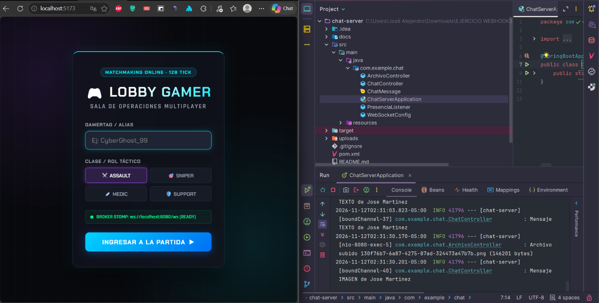

---

### B. Sala Táctica y Mensajes de Texto en Tiempo Real
Visualización del chat en vivo con el tema gamer, indicando entrada del jugador y mensajes sincronizados:

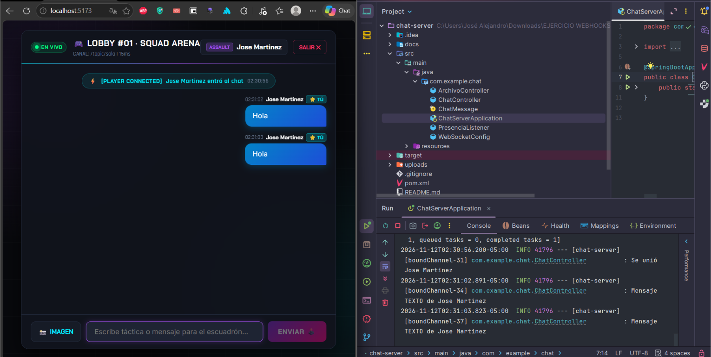

---

### C. Subida de Imagen por el Jugador Jose Martinez
El jugador sube una captura desde su equipo; la imagen se procesa por HTTP y viaja en milisegundos a la sala:

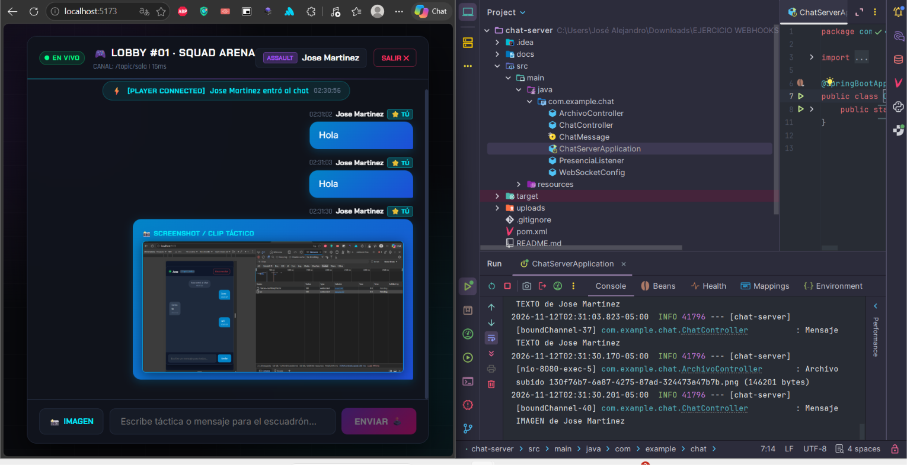

---

### D. Interacción Multiusuario con Subida de Capturas (Jugador Perez)
El segundo jugador `Perez` (`[SUPPORT]`) ingresa a la sala y comparte otra captura, validando la sincronización en vivo:

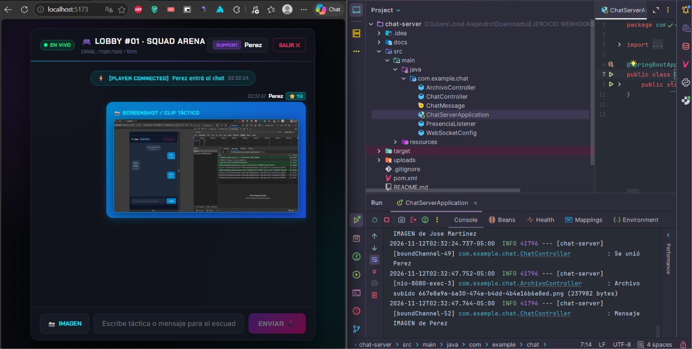

---

### E. Muro Táctico Multiusuario con Múltiples Capturas
Vista general del chat donde se aprecian múltiples capturas e interacciones compartidas entre los jugadores del lobby:

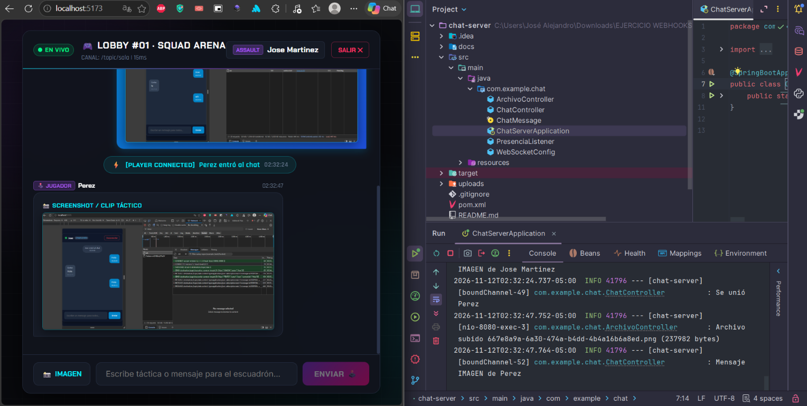

---

### F. Evidencias de Red y Handshake HTTP 101 (Parte 1)
Inspección en DevTools de la elevación de protocolo HTTP a WebSocket (`101 Switching Protocols`):

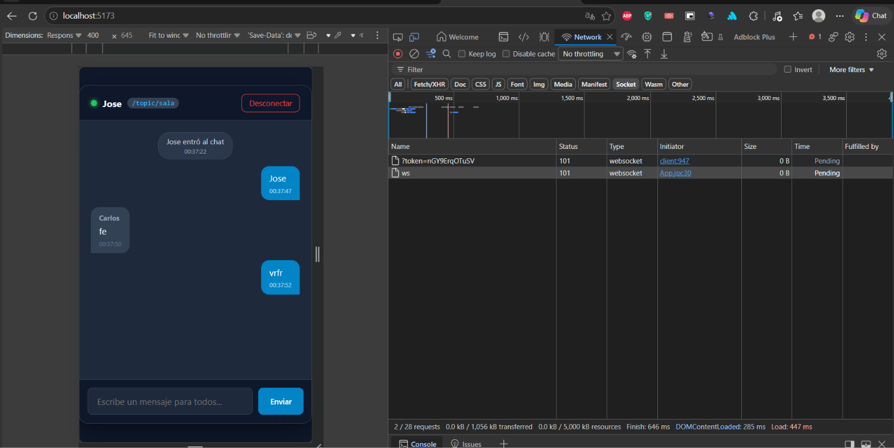

---

### G. Frames STOMP Bidireccionales (Parte 1)
Inspección de frames `CONNECT`, `CONNECTED`, `SUBSCRIBE`, `SEND` y `MESSAGE` en la pestaña de mensajes WebSocket:

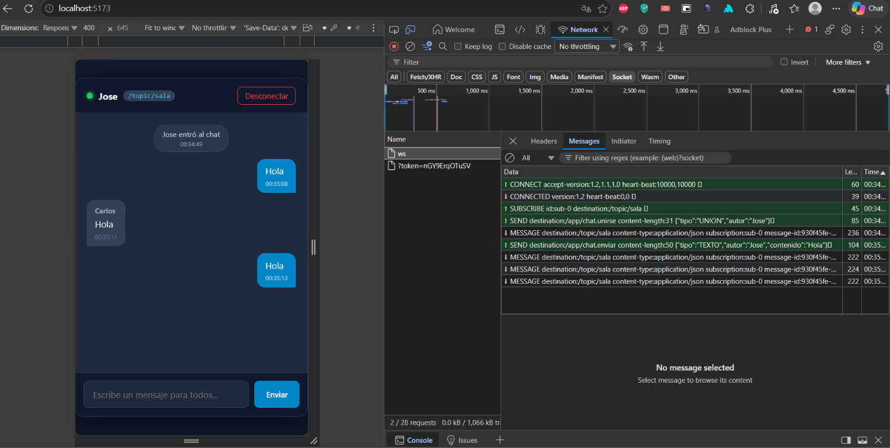

---

### H. Chat Concurrente en Múltiples Pestañas (Parte 1)
Prueba en vivo con múltiples usuarios en pestañas simultáneas compartiendo la sala:

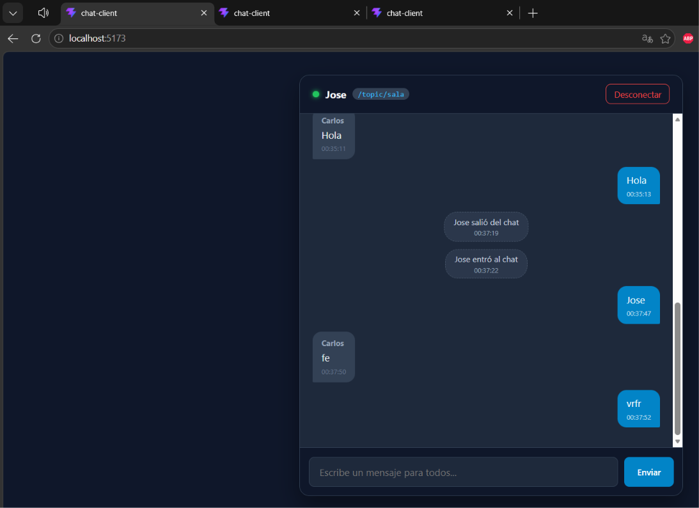
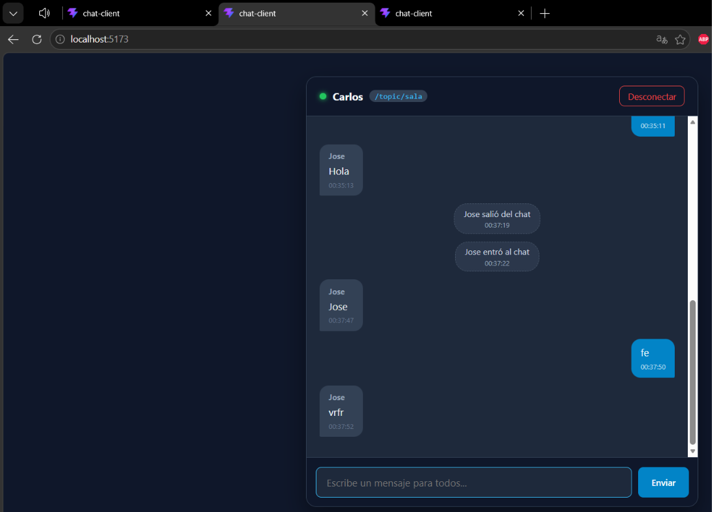
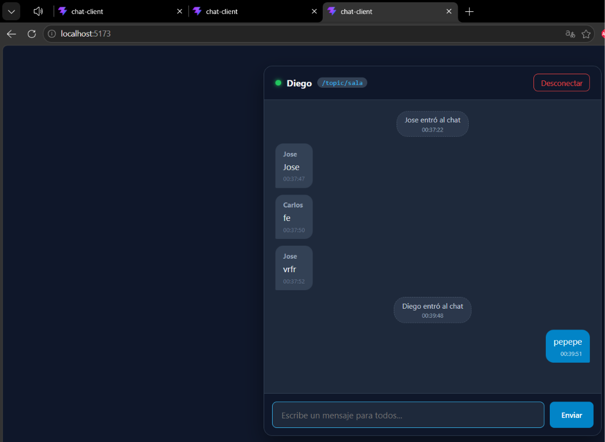

---

## 📊 7. Observabilidad y Monitoreo en Tiempo Real (Parte 3)

Toda la interacción de los clientes web en el Lobby Gamer (entradas, salidas, mensajes y subidas de imágenes) es monitoreada por el stack de observabilidad configurado en `chat-server/observabilidad`.

### Cómo levantar la observabilidad:
```bash
# Desde la carpeta chat-server
cd ../chat-server/observabilidad
docker compose up -d
```
El tablero se encuentra pre-configurado y disponible en **Grafana** (`http://localhost:3000`, credenciales `admin` / `admin`):

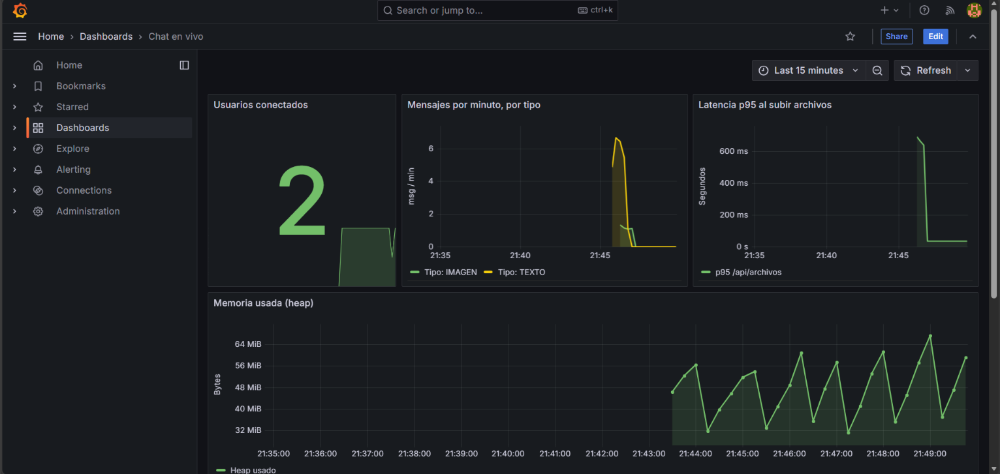

---

## 🧠 8. Preguntas Conceptuales de Sustentación

### 1. ¿Por qué un chat con HTTP tradicional tendría que estar preguntando cada segundo (polling) y qué cambia con WebSocket?
* **Limitación de HTTP tradicional (Short Polling):** HTTP es un protocolo unidireccional y sin estado basado en el modelo petición-respuesta (*request-response*). El servidor no puede iniciar comunicación de manera proactiva hacia el navegador. Para simular tiempo real, el cliente debe abrir y cerrar conexiones TCP periódicamente cada segundo mediante polling, incurriendo en un consumo masivo de CPU, ancho de banda y latencia debido a cabeceras repetitivas y peticiones mayoritariamente vacías.
* **Ventaja del WebSocket:** Tras un único handshake inicial (`101 Switching Protocols`), se mantiene un canal TCP bidireccional (*full-duplex*) persistente. Cuando un cliente envía un mensaje, el broker lo retransmite (*push*) a todos los suscriptores en milisegundos con un overhead mínimo de apenas unos bytes por frame.

### 2. ¿Por qué las imágenes y los audios se suben por HTTP y no viajan dentro del WebSocket?
* **Evitar saturación del canal en tiempo real:** Los archivos binarios pesados (imágenes, audios o videos) codificados en Base64 o transmitidos en bloques binarios por el WebSocket bloquean los buffers de red y los hilos del broker de mensajería, degradando drásticamente la latencia de los mensajes de texto de todos los usuarios conectados.
* **Aprovechamiento de la infraestructura HTTP:** HTTP cuenta con optimizaciones nativas para transferencias pesadas: subidas multipart en streaming, compresión eficiente, reintentos de red y mecanismos de caché en el navegador y CDNs. Por ende, la arquitectura óptima es: **el archivo se sube por HTTP POST a una API REST, y únicamente la URL resultante se difunde a través del WebSocket**.

### 3. Si el servidor se reinicia, ¿qué pasa con los usuarios conectados y qué hace `reconnectDelay`?
* Si el servidor se apaga o reinicia, las conexiones TCP activas caen de inmediato, provocando el cierre del socket (`onWebSocketClose`) en los navegadores.
* La propiedad `reconnectDelay: 3000` de `@stomp/stompjs` activa una rutina automática de reintento en segundo plano. En lugar de dejar la aplicación congelada o requerir que el usuario recargue el navegador, el cliente intenta reconectarse periódicamente cada 3 segundos al endpoint `/ws` hasta que el servidor vuelve a responder, reestableciendo la suscripción a `/topic/sala` de forma transparente.

### 4. ¿Qué métrica te avisaría primero de que el chat está fallando, y qué alerta pondrías sobre ella?
* **Métrica principal:** La tasa de desconexiones anómalas o la tasa de errores HTTP/WebSocket (`rate(http_server_requests_seconds_count{status=~"5.."}[1m])` o caídas abruptas a 0 en `chat_usuarios_conectados` en periodos de alto tráfico).
* **Alerta recomendada:** Una alerta en Prometheus/Grafana sobre la tasa de errores 5xx del servidor o latencia p95:
  ```promql
  sum(rate(http_server_requests_seconds_count{status=~"5.."}[1m])) > 0
  ```
  Si se presentan errores de servidor por más de 1 minuto consecutivo, disparar una alerta crítica (Severity: Critical) vía webhook/Slack/email para atención inmediata del equipo de operaciones.

### 5. En Style Radar, ¿qué servicio se beneficiaría de WebSockets y qué tablero le armarías a cada microservicio?
* **Servicio beneficiado:** El servicio de **Probador Virtual / Recomendaciones en Tiempo Real** (`virtual-tryon-service`) y el servicio de **Notificaciones de Ofertas / Tendencias**. En lugar de que el usuario haga polling esperando si su prenda ya fue procesada por el modelo de IA o si hay una nueva alerta de estilo, el backend empuja la notificación o el render 3D terminado de inmediato mediante WebSocket.
* **Tableros en Grafana por microservicio:**
  * **API Gateway:** Métricas de throughput global (req/sec), tasa de errores HTTP (4xx/5xx) y latencia p99 de enrutamiento.
  * **Servicio de Catálogo / Estilos:** Tasa de aciertos de caché (Redis hit ratio), latencia de consultas a la base de datos (PostgreSQL) y consumo de memoria Heap.
  * **Probador Virtual (IA / WebSockets):** Conexiones WebSocket activas simultáneas, longitud de la cola de procesamiento de imágenes (RabbitMQ queue depth), latencia de inferencia del modelo y porcentaje de utilización de GPU/CPU.
